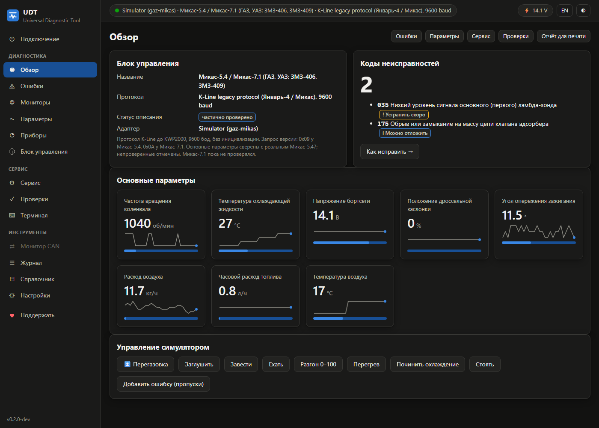
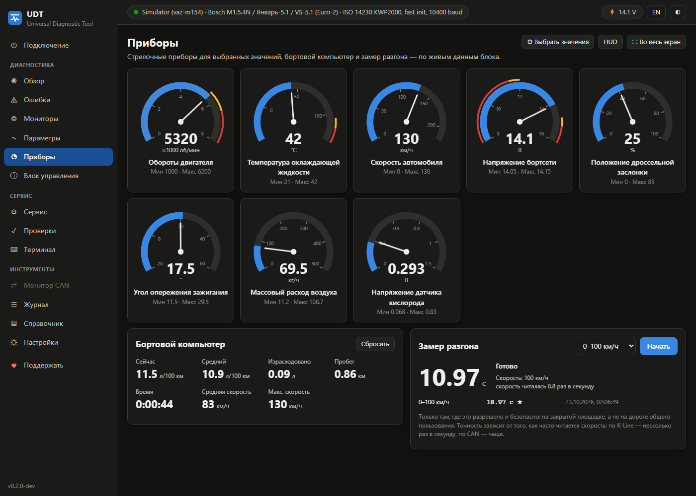
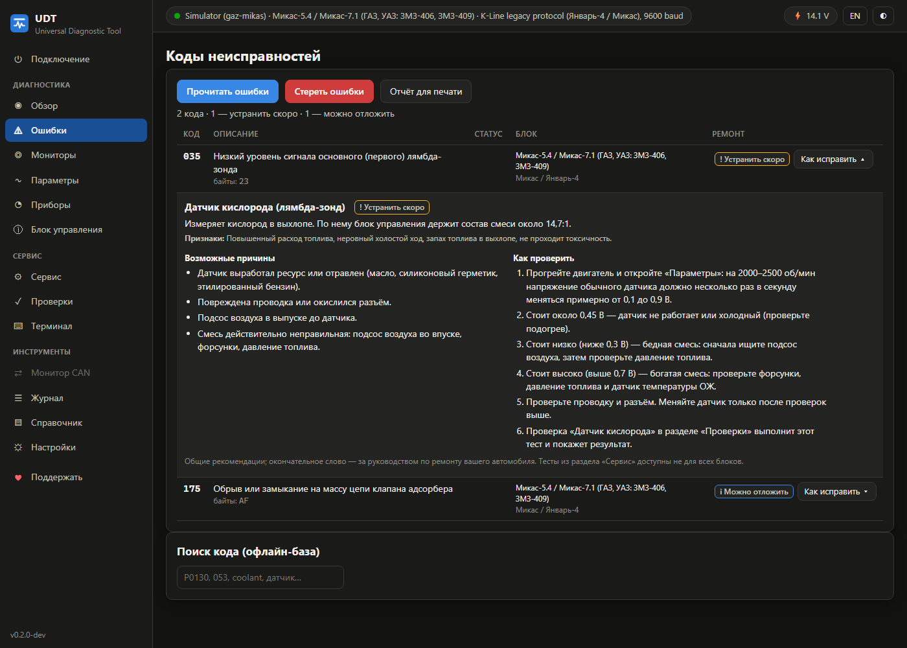
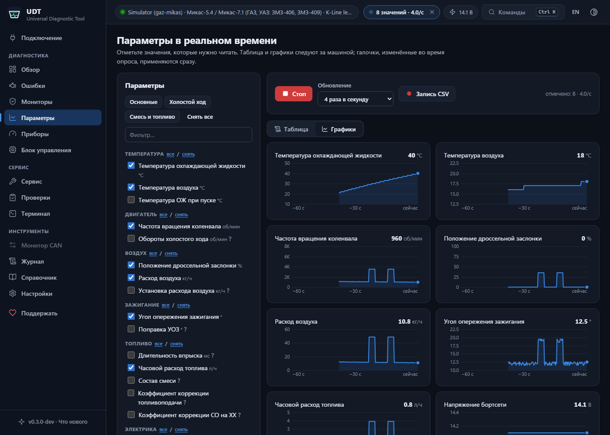
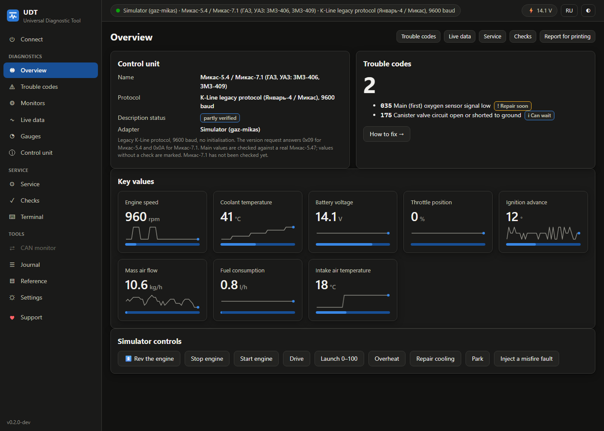
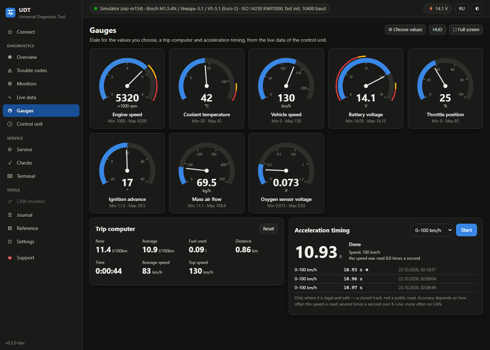
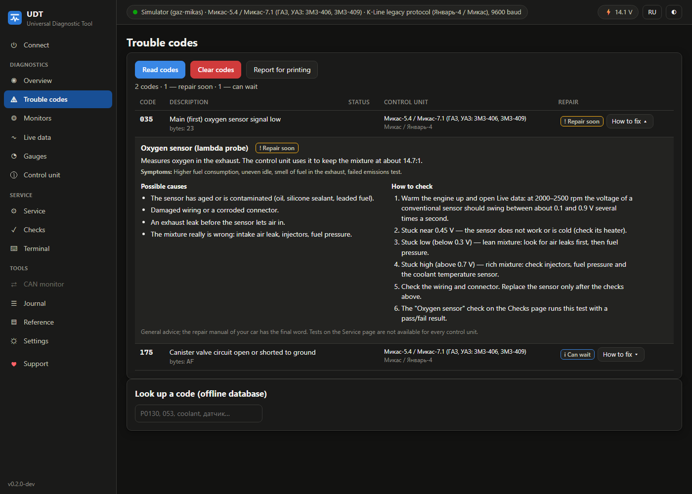

<a id="ru"></a>

**Русский** · [English](#eng)

# Universal Diagnostic Tool

[](https://github.com/AristarhUcolov/universal-diagnostic-tool/actions/workflows/ci.yml)
[](LICENSE)
[](https://ko-fi.com/AristarhUcolov)
[](https://buymeacoffee.com/aristarh.ucolov)
[](https://www.donationalerts.com/c/aristarh_ucolov)

Бесплатная программа для диагностики легковых автомобилей, грузовиков,
автобусов и техники через компьютер — с тем адаптером, который у вас уже есть:
K-Line кабель (VAG KKL 409.1), ELM327, OBDLink, J2534 PassThru, USB-CAN,
грузовые адаптеры RP1210, Ethernet-кабель (DoIP, BMW ENET). Читает и стирает
ошибки с расшифровкой на **русском и английском**, показывает работу двигателя
в реальном времени, проверяет исполнительные механизмы и записывает **каждый
байт** обмена в журнал. Без лицензий, подписок, привязки к адаптеру и
интернета.

Работает и со старыми отечественными блоками, которые не понимают ни
приложения для ELM327, ни многие дорогие сканеры: **Микас-5.4 / 7.1**
(ГАЗ-3110 «Волга», ГАЗель, УАЗ с ЗМЗ-406/409), **Январь-4 / 5.1 / 7.2**,
**Bosch M1.5.4 / M7.9.7** — и с любой машиной с OBD-II / EOBD.



**Разделы:** [Зачем](#зачем) · [Скачать](#скачать-и-запустить) ·
[Что умеет](#что-умеет) · [Адаптеры](#адаптеры) ·
[Автомобили](#автомобили-и-блоки-управления) ·
[Конвертер протоколов](#конвертер-протоколов) ·
[Честно о возможностях](#честно-о-возможностях) ·
[Устройство](#устройство-программы) · [Документация](#документация) ·
[Поддержать](#поддержать-проект) · [Лицензия](#лицензия)

---

## Зачем

Кабель-адаптер стоит как обед в кафе, а программа к нему часто дороже самого
кабеля. Одна работает только со «своим» адаптером, другая — по подписке, третья
— только у дилера, четвёртая не знает блоков, которые стоят на половине машин
в гаражах. Владелец остаётся с лампой «Check Engine» и без ответа на простой
вопрос: что сломалось?

Universal Diagnostic Tool — одна открытая программа для многих адаптеров и
протоколов. Код открыт, описания блоков и база кодов — обычные текстовые
файлы, которые может проверить и дополнить любой.

## Скачать и запустить

**Windows 10/11:** скачайте `udt.exe` со страницы
[Releases](https://github.com/AristarhUcolov/universal-diagnostic-tool/releases)
и запустите — установка не нужна. Программа откроется в своём окне (WebView2
уже есть в Windows 10/11; если его нет, откроется браузер).

**32-битный драйвер J2534 или RP1210** (таких большинство: Tactrix OpenPort
2.0, Mini-VCI, Scanmatik, Nexiq…) загружается только 32-битной программой —
возьмите `udt-x86.exe`. Если разрядность не совпадёт, программа так и скажет.

**Linux, Raspberry Pi, macOS:** `udt-linux-amd64`, `udt-linux-arm64`,
`udt-linux-armv7`, `udt-macos-arm64` — интерфейс откроется в браузере. На
Linux добавьте пользователя в группу `dialout`, чтобы открыть COM-порт.

**Всё хранится рядом с программой.** Настройки, журналы, записи и отчёты лежат
в папке `udt-data` рядом с `udt.exe`: скопируйте программу вместе с этой
папкой на флешку или другой компьютер — и всё переедет. Если в папку
программы нельзя записывать (например, Program Files), данные хранятся в
профиле пользователя. Настройки и журналы прежних версий из `%APPDATA%\udt`
при первом запуске копируются в `udt-data` сами.

**Из исходников** (нужен Go 1.26):

```bash
git clone https://github.com/AristarhUcolov/universal-diagnostic-tool
cd universal-diagnostic-tool
go run ./cmd/udt                               # окно программы
go build -o udt.exe ./cmd/udt                  # Windows, 64 бита
GOARCH=386 go build -o udt-x86.exe ./cmd/udt   # для 32-битных драйверов J2534/RP1210
```

**Без машины** можно начать сразу: выберите адаптер «Симулятор». Внутри —
модель двигателя и одиннадцать виртуальных автомобилей: ГАЗ-3110 с
Микас-7.1, ВАЗ-2112 с Январь-7.2, ВАЗ-2110 с Bosch M1.5.4N, ВАЗ-21093
«Россия-83», европейский автомобиль с OBD-II по K-Line, VW Golf IV (KW1281),
современная машина с OBD-II и UDS по CAN, машина 2021 года с UDS по CAN FD,
VW Passat B6 (TP 2.0), грузовик J1939 и автомобиль с диагностикой по Ethernet
(DoIP). У симулятора есть кнопки «Ехать», «Разгон 0–100», «Перегрев» и
«Добавить ошибку», чтобы попробовать все разделы.

## Что умеет

- **Ошибки** — чтение и стирание; расшифровка из встроенной базы (656
  описаний: SAE J2012, ВАЗ/ГАЗ/УАЗ KWP2000, Микас, VAG) на русском и
  английском; статусы (активна, подтверждена, ожидает, лампа MIL); стоп-кадр
  OBD-II; отчёт для печати.
- **Как исправить** — у каждого кода: что делает узел, признаки, причины от
  простых к дорогим, как проверить и насколько это срочно («опасно ехать»,
  «устранить скоро», «можно отложить»). 33 раздела справочника по ремонту на
  русском и английском — в разделе «Ошибки», в отчёте и без подключения.
- **Параметры в реальном времени** — таблица с минимумом и максимумом,
  графики (у каждого параметра своя ось), готовые наборы («Основные»,
  «Холостой ход», «Смесь и топливо»), запись в CSV и «сырые записи» с
  подсветкой меняющихся байтов — чтобы изучать новые блоки.
- **Обзор** — главные значения плитками с цветом по порогам, готовность
  мониторов OBD-II, напряжение бортсети, быстрые действия.
- **Приборы** — стрелочные приборы для выбранных значений, режим HUD для
  лобового стекла, бортовой компьютер (мгновенный и средний расход, пробег,
  время, средняя и максимальная скорость) и замер разгона 0–60, 0–100,
  60–100, 80–120 км/ч и 402 м.
- **Мониторы** — готовность мониторов OBD-II и результаты самопроверок блока
  (режим 06) с допусками: датчики кислорода, катализатор, пропуски
  зажигания по каждому цилиндру. Деталь на грани допуска видна раньше, чем
  появится код ошибки.
- **Предупреждения** — перегрев, низкое или слишком высокое напряжение,
  перекрут: сообщение, отметка в верхней строке и звук на любой странице.
- **Сервис** — перезагрузка блока управления (связь восстанавливается
  сама); проверка форсунок, катушек, бензонасоса, вентилятора, клапанов;
  регулировка оборотов холостого хода и положения РДВ в реальном времени:
  ползунок и кнопки шага сразу меняют обороты, а график показывает заданные
  и фактические. Программа не запустит тест, если двигатель не в нужном
  состоянии, и сама вернёт блоку всё включённое по таймеру.
- **Проверки** — пошаговые проверки с оценкой «норма / не норма»:
  аккумулятор и генератор, прогрев и термостат, холостой ход, датчик
  кислорода, датчик положения дросселя.
- **Терминал** — любой запрос в hex и сырой ответ: KWP2000, UDS, OBD-II,
  Микас, KW1281.
- **Монитор шины CAN** — все кадры, период, расшифровка J1939; отправка
  кадров в режиме эксперта.
- **Журнал** — каждый байт в обе стороны, события протокола и ошибки; поиск,
  экспорт в CSV, файл на диске для разбора или отправки специалисту.
- **Мост ELM327** — программа представляется Wi-Fi ELM327, и приложения,
  которые умеют с ним работать, видят машину через ваше подключение. Даже
  блоки без OBD-II (Микас, Январь) выглядят для них как OBD-II автомобиль.
- **С телефона или планшета** — интерфейс открывается в браузере любого
  устройства в той же сети.
- **Командная строка** — `udt scan`, `udt dtc`, `udt live`, `udt raw`,
  `udt reset`, `udt bridge`, `udt lookup` для скриптов и слабых ноутбуков.
- **RU / EN**, тёмная и светлая тема, метрические и имперские единицы.







## Адаптеры

| Адаптер | Подключение | Что умеет в программе |
|---|---|---|
| K-Line кабель: VAG KKL 409.1 (FTDI, CH340), K+DCAN в режиме K-Line, RS232 KKL, переходники ГАЗ/ВАЗ 12-pin | COM-порт | все протоколы K-Line: KWP2000, ISO 9141-2, Микас-5.4/7.1, Январь-4, VW KW1281 |
| ELM327 USB / Bluetooth / Wi-Fi, OBDLink SX/LX/MX+/EX, STN1110/2120, vLinker | COM-порт, Wi-Fi | OBD-II (все пять протоколов), KWP2000 ВАЗ/ГАЗ/УАЗ, UDS |
| ELM327 Bluetooth LE (BLE 4.0): Vgate iCar Pro BLE, Veepeak OBDCheck BLE, vLinker BLE, OBDLink CX | Bluetooth LE, кнопка «Найти» | то же, что ELM327 |
| J2534 PassThru: Tactrix OpenPort 2.0, Scanmatik 2, Mini-VCI, VCM II, MDI, MVCI, VXDIAG, Godiag GD101, Autel MaxiFlash… | драйвер производителя | OBD-II, KWP2000, UDS, VW TP 2.0, J1939, монитор CAN |
| USB-CAN: CANable / CANable 2.0, CANtact, Lawicel CANUSB (slcan); PEAK PCAN-USB (FD); Kvaser; SocketCAN на Linux | COM-порт или драйвер | OBD-II, UDS (также по CAN FD), VW TP 2.0, J1939, монитор CAN |
| Грузовые RP1210: Nexiq USB-Link, Noregon DLA+, Dearborn DPA5, Cummins INLINE, CAT CA3, Jaltest Link… | драйвер производителя | SAE J1939 |
| Ethernet: кабель OBD–RJ45 (DoIP), BMW ENET (HSFZ) | сеть | UDS, OBD-II по DoIP |

Что работает напрямую, что — через драйвер J2534/RP1210, а что закрыто
производителем, по сотням конкретных адаптеров:
**[docs/ADAPTERS.md](docs/ADAPTERS.md)**.

## Автомобили и блоки управления

- **Любой автомобиль с OBD-II / EOBD** (США с 1996 года, Европа — бензиновые
  с 2001, дизельные с 2004): ошибки, параметры, готовность, стоп-кадр, VIN.
- **ВАЗ, ГАЗ, УАЗ по K-Line:** Bosch M1.5.4N, Январь-5.1, VS-5.1, Январь-7.2,
  Bosch M7.9.7, Микас-10.3/11 по KWP2000; Микас-5.4/7.1 и Январь-4 — по
  раннему протоколу (9600 бод, без инициализации).
- **VW, Audi, Seat, Skoda:** KW1281 по K-Line (примерно до 2005 года), KWP2000
  на TP 2.0 по CAN (экспериментально), UDS.
- **Грузовики, автобусы, тракторы (SAE J1939):** обороты, температуры,
  давление масла, расход, пробег, моточасы; активные (DM1) и сохранённые
  (DM2) ошибки с SPN/FMI; стирание (DM3, DM11).
- **Любой блок с KWP2000 или UDS:** по адресу на K-Line или CAN-
  идентификаторам — идентификация, ошибки, терминал.

Описание блока — это JSON-файл: адреса, запросы, формулы. Добавить свой блок
можно без программирования: **[docs/ECU-DEFINITIONS.md](docs/ECU-DEFINITIONS.md)**.

Для ГАЗ-3110 «Волга» с ЗМЗ-406, кабелем KKL 409.1 и переходником 12-pin есть
пошаговая инструкция: **[docs/GAZ-VOLGA.md](docs/GAZ-VOLGA.md)**.

## Конвертер протоколов

Программа устроена слоями: адаптер → канал «запрос — ответ» → протокол
(KWP2000, UDS, OBD-II, Микас, KW1281, J1939) → единый интерфейс блока
управления. Всё, что выше канала, работает с любым адаптером, который этот
канал умеет. Один и тот же код читает ошибки Январь-7.2 через KKL-кабель,
ELM327 или J2534, а OBD-II — по K-Line, J1850, CAN или Ethernet.

Второй конвертер — **мост ELM327**: программа принимает команды ELM327 по
сети и отвечает от имени машины. Для блока на K-Line (например, Микас-7.1)
она сама переводит запросы OBD-II в запросы его протокола и собирает ответы
OBD-II из его параметров и кодов.

Чего программа сделать не может — так это поменять провода. K-Line и CAN —
это разные линии с разными уровнями сигнала и разными микросхемами в
адаптере. Адаптер только с K-Line не заговорит по CAN, а блок на K-Line не
появится на шине CAN без отдельного шлюза. Подробно:
**[docs/PROTOCOLS.md](docs/PROTOCOLS.md)**.

## Честно о возможностях

- **Что проверено.** Каждый протокол и каждый тип адаптера проверяется
  автотестами на встроенном симуляторе; форматы взяты из опубликованных
  спецификаций. **На настоящей машине** программа проверена с ГАЗ-3110
  (ЗМЗ-406, Микас-5.47) через кабель VAG KKL 409.1 на FTDI и переходник
  12-pin: паспорт блока, ошибки и параметры двигателя. Эта проверка нашла
  три расхождения с опубликованным описанием протокола Микас — они
  исправлены, а кадры настоящего блока вошли в автотесты вместе с ответом
  Январь-7.2. Стирание ошибок Микас, сервисные функции на настоящем блоке и
  другие адаптеры — особенно J2534, RP1210, PCAN, Kvaser, DoIP — ещё не
  испытывались. Если у вас есть адаптер и машина, проверьте и напишите в
  [issues](https://github.com/AristarhUcolov/universal-diagnostic-tool/issues),
  приложив файл журнала. Это самая ценная помощь проекту.
- **Описания блоков честно помечены:** «проверено» — по официальной
  спецификации, «частично», «не проверено». Параметр, формула которого не
  сверена с реальным блоком, отмечен знаком «?». Сверяйтесь с сырым
  значением, прежде чем менять деталь.
- **Прошивки блоков в интерфейсе нет.** Ошибка при записи превращает блок в
  «кирпич», а контрольные суммы и защита доступа у каждого производителя
  свои. В библиотеке есть загрузка по UDS (34/36/37) для разработчиков, но
  кнопки «прошить» не будет, пока она не станет безопасной.
- **Не делает и не будет делать:** программирование ключей и иммобилайзеров,
  обход противоугонных систем, изменение пробега. На этом держатся угоны и
  обман покупателей.
- **Закрытые адаптеры** — VCDS HEX-V2/HEX-NET, OBDeleven, Carista, BlueDriver,
  Launch DBScar, многие дилерские VCI без драйвера J2534 — работают только со
  своими программами: их протокол зашифрован или привязан к серверу
  производителя.
- **Пока не поддерживаются:** J1708/J1587 (грузовики до 2007 года), GM ALDL,
  Chrysler SCI/CCD, D-PDU API (ISO 22900-2). FlexRay, LIN и MOST к
  диагностическому разъёму не выведены: блоки на этих шинах диагностируются
  через шлюз по CAN или Ethernet (DoIP), а это программа умеет. Bluetooth LE
  работает в Windows и Linux, но на настоящих адаптерах ещё не проверялся; в
  сборке для macOS его нет. CAN FD проверен на симуляторе.

## Устройство программы

```
cmd/udt/              точка входа: окно, сервер интерфейса, командная строка
internal/serial       COM-порты (Windows, Linux, macOS), поиск адаптеров по USB VID:PID
internal/kline        K-Line: эхо, быстрая и 5-бодовая инициализация, точные тайминги
internal/kwp2000      ISO 14230 (KWP2000) на K-Line
internal/iso9141      ISO 9141-2 (OBD-II на K-Line)
internal/legacy       ранний протокол Микас-5.4/7.1 и Январь-4
internal/kw1281       VW KW1281
internal/can, isotp   CAN и ISO 15765-2 (ISO-TP)
internal/uds          ISO 14229 (UDS), в том числе загрузка 34/36/37
internal/obd          SAE J1979 (OBD-II): PID, ошибки, готовность, VIN
internal/tp20         VW TP 2.0
internal/j1939        SAE J1939: адреса, BAM, DM1/DM2/DM3/DM11, SPN
internal/doip         ISO 13400 (DoIP) и BMW HSFZ
internal/elm327       драйвер ELM327/STN и эмулятор для моста
internal/ble          адаптеры ELM327 по Bluetooth LE
internal/slcan, pcan, kvaser, socketcan, j2534, rp1210   CAN-адаптеры и драйверы
internal/ecu          описания блоков (JSON), формулы, обработчики
internal/dtc          база кодов неисправностей
internal/repair       справочник по ремонту: советы к кодам (JSON)
internal/sim          симулятор: модель двигателя, виртуальные шины K-Line и CAN
internal/vehicle      подключение и автоопределение, опрос, запись, монитор
internal/bridge       мост ELM327 для приложений
internal/server       веб-интерфейс (встроен в программу), API, отчёт
```

Чистый Go без cgo: один исполняемый файл без зависимостей, драйверы адаптеров
подключаются при запуске. Интерфейс открыт только для этого компьютера
(127.0.0.1) и защищён ключом сеанса; доступ из сети включается явно.

## Документация

- **[docs/GUIDE.md](docs/GUIDE.md)** — руководство: подключение, все разделы
  программы, командная строка, мост ELM327, если не связывается.
- **[docs/GAZ-VOLGA.md](docs/GAZ-VOLGA.md)** — ГАЗ-3110 / ЗМЗ-406 с кабелем
  KKL 409.1: от проводки до чтения ошибок.
- **[docs/ADAPTERS.md](docs/ADAPTERS.md)** — совместимость адаптеров.
- **[docs/CONNECTORS.md](docs/CONNECTORS.md)** — диагностические разъёмы.
- **[docs/PROTOCOLS.md](docs/PROTOCOLS.md)** — протоколы и что такое
  «конвертер».
- **[docs/ECU-DEFINITIONS.md](docs/ECU-DEFINITIONS.md)** — как описать свой
  блок управления и дополнить базу кодов.
- **[CONTRIBUTING.md](CONTRIBUTING.md)** — как помочь проекту.

## Поддержать проект

Программа бесплатная и останется такой: без рекламы, без подписки, без сбора
данных. Поддержка оплачивает время на разработку, адаптеры для проверки и
испытания на настоящих машинах.

| | |
|---|---|
| **Ko-fi** — разово или ежемесячно, картой из любой страны | [ko-fi.com/AristarhUcolov](https://ko-fi.com/AristarhUcolov) |
| **Buy Me a Coffee** — быстрый платёж картой | [buymeacoffee.com/aristarh.ucolov](https://buymeacoffee.com/aristarh.ucolov) |
| **DonationAlerts** — удобно из России и стран СНГ | [donationalerts.com/c/aristarh_ucolov](https://www.donationalerts.com/c/aristarh_ucolov) |

Те же ссылки — в программе, раздел **«♥ Поддержать»** в боковом меню, и за
кнопкой **Sponsor** на странице репозитория.

**Помочь без денег** — не менее ценно: проверить программу со своим адаптером
и автомобилем, прислать журнал сеанса, сверить описание блока с руководством
по ремонту или добавить коды неисправностей — см.
[CONTRIBUTING.md](CONTRIBUTING.md).

## Лицензия

[GNU AGPL-3.0](LICENSE). Пользоваться, изучать, изменять и распространять
можно свободно. Изменённую версию — в том числе работающую как сетевой сервис
— нужно публиковать с исходным кодом под той же лицензией.

## Оговорка

Программа предоставляется «как есть», без каких-либо гарантий. Диагностика
вмешивается в работу блоков управления: стирайте ошибки, включайте
исполнительные механизмы и отправляйте запросы из терминала только на
неподвижной машине и понимая, что делаете. Не управляйте программой за рулём.
Названия производителей и адаптеров упомянуты только для указания
совместимости; проект с ними не связан.

---
---

<a id="eng"></a>

[Русский](#ru) · **English**

# Universal Diagnostic Tool

A free program for diagnosing cars, trucks, buses and machinery from a
computer — with the adapter you already own: a K-Line cable (VAG KKL 409.1),
ELM327, OBDLink, J2534 PassThru, USB-CAN, RP1210 truck adapters, an Ethernet
cable (DoIP, BMW ENET). It reads and clears trouble codes with descriptions in
**English and Russian**, shows the engine at work in real time, tests
actuators and logs **every byte** of the exchange. No licences, subscriptions,
adapter lock-in or internet connection.

It also talks to old Russian control units that ELM327 apps and many
expensive scanners do not understand — **Микас-5.4 / 7.1** (GAZ-3110 Volga,
GAZelle, UAZ with ZMZ-406/409 engines), **Январь-4 / 5.1 / 7.2**, **Bosch
M1.5.4 / M7.9.7** — and to any car with OBD-II / EOBD.



**Sections:** [Why](#why) · [Download](#download-and-run) ·
[What it does](#what-it-does) · [Adapters](#adapters) ·
[Vehicles](#vehicles-and-control-units) ·
[Protocol converter](#protocol-converter) ·
[Honestly about the limits](#honestly-about-the-limits) ·
[Structure](#program-structure) · [Documentation](#documentation) ·
[Support](#support-the-project) · [Licence](#licence)

---

## Why

An adapter cable costs as much as a lunch, and the software for it often
costs more than the cable. One program works only with "its own" adapter,
another needs a subscription, a third runs only at the dealer, a fourth does
not know the control units fitted to half the cars in people's garages. The
owner is left with a check-engine light and no answer to a simple question:
what is broken?

Universal Diagnostic Tool is one open program for many adapters and
protocols. The code is open, and the control unit descriptions and the trouble
code database are plain text files that anyone can check and extend.

## Download and run

**Windows 10/11:** download `udt.exe` from the
[Releases](https://github.com/AristarhUcolov/universal-diagnostic-tool/releases)
page and run it — no installation. The program opens in its own window
(WebView2 is part of Windows 10/11; without it the browser opens).

**A 32-bit J2534 or RP1210 driver** (most of them are: Tactrix OpenPort 2.0,
Mini-VCI, Scanmatik, Nexiq…) can only be loaded by a 32-bit program — use
`udt-x86.exe`. If the bitness does not match, the program says so.

**Linux, Raspberry Pi, macOS:** `udt-linux-amd64`, `udt-linux-arm64`,
`udt-linux-armv7`, `udt-macos-arm64` — the interface opens in the browser. On
Linux add your user to the `dialout` group to open serial ports.

**Everything is kept next to the program.** Settings, journals, recordings
and reports live in the `udt-data` folder next to `udt.exe`: copy the program
together with that folder to a flash drive or another computer and everything
moves with it. Where the program's folder cannot be written (Program Files,
for example), the data is kept in the user profile. Settings and journals of
earlier versions in `%APPDATA%\udt` are copied into `udt-data` on the first
start.

**From source** (Go 1.26):

```bash
git clone https://github.com/AristarhUcolov/universal-diagnostic-tool
cd universal-diagnostic-tool
go run ./cmd/udt                               # the program window
go build -o udt.exe ./cmd/udt                  # Windows, 64-bit
GOARCH=386 go build -o udt-x86.exe ./cmd/udt   # for 32-bit J2534/RP1210 drivers
```

**No car needed** to start: pick the "Simulator" adapter. It contains an
engine model and eleven virtual vehicles: GAZ-3110 with Микас-7.1, VAZ-2112
with Январь-7.2, VAZ-2110 with Bosch M1.5.4N, VAZ-21093 "Russia-83", a
European car with OBD-II on K-Line, VW Golf IV (KW1281), a modern car with
OBD-II and UDS on CAN, a 2021 car with UDS on CAN FD, VW Passat B6 (TP 2.0), a
J1939 truck and a car with Ethernet diagnostics (DoIP). The simulator has
"Drive", "Launch 0–100", "Overheat" and "Inject a fault" buttons to try every
page.

## What it does

- **Trouble codes** — read and clear; descriptions from the built-in database
  (656 entries: SAE J2012, VAZ/GAZ/UAZ KWP2000, Микас, VAG) in English and
  Russian; status (active, confirmed, pending, MIL); OBD-II freeze frame;
  printable report.
- **How to fix** — for every code: what the part does, symptoms, causes from
  cheap to expensive, how to check them and how urgent it is ("driving on is
  risky", "repair soon", "can wait"). 33 sections of repair advice in English
  and Russian — on the codes page, in the report and offline.
- **Live data** — a table with minimum and maximum, charts (one axis per
  parameter), ready-made sets ("Key values", "Idle", "Mixture and fuel"), CSV
  recording and "raw records" that highlight changing bytes — for exploring
  new control units.
- **Overview** — key values as tiles coloured by thresholds, OBD-II monitor
  readiness, battery voltage, quick actions.
- **Gauges** — dials for the values you choose, a HUD mode for the
  windscreen, a trip computer (current and average consumption, distance,
  time, average and top speed) and acceleration timing: 0–60, 0–100, 60–100,
  80–120 km/h and 402 m.
- **Monitors** — OBD-II monitor readiness and the controller's own test
  results (service 06) against their limits: oxygen sensors, catalyst,
  misfires per cylinder. A part close to its limit shows up before any
  trouble code.
- **Alerts** — overheating, low or too high voltage, over-revving: a
  message, a mark in the top bar and a sound, on any page.
- **Service** — restart the control unit (communication comes back by
  itself); test injectors, coils, fuel pump, fan and valves; set the idle
  speed and the idle air valve in real time: the slider and step buttons
  change the engine speed at once, and a chart shows the target and the
  actual value. A test does not start unless the engine is in the state it
  needs, and anything left on is handed back to the unit by a timer.
- **Checks** — step-by-step checks with a pass or fail verdict: battery and
  charging, warm-up and thermostat, idle, oxygen sensor, throttle sensor.
- **Terminal** — any request in hex and the raw answer: KWP2000, UDS, OBD-II,
  Микас, KW1281.
- **CAN bus monitor** — every frame, its period, J1939 decoding; sending
  frames in expert mode.
- **Journal** — every byte in both directions, protocol events and errors;
  search, CSV export, a file on disk to study or send to a specialist.
- **ELM327 bridge** — the program poses as a Wi-Fi ELM327, so apps that
  work with one see the car through your connection. Even control units
  without OBD-II (Микас, Январь) look like an OBD-II car to them.
- **From a phone or tablet** — the interface opens in the browser of any
  device on the same network.
- **Command line** — `udt scan`, `udt dtc`, `udt live`, `udt raw`,
  `udt reset`, `udt bridge`, `udt lookup` for scripts and slow laptops.
- **EN / RU**, dark and light theme, metric and imperial units.





## Adapters

| Adapter | Connection | What it does in the program |
|---|---|---|
| K-Line cable: VAG KKL 409.1 (FTDI, CH340), K+DCAN in K-Line mode, RS232 KKL, GAZ/VAZ 12-pin adapters | serial port | every K-Line protocol: KWP2000, ISO 9141-2, Микас-5.4/7.1, Январь-4, VW KW1281 |
| ELM327 USB / Bluetooth / Wi-Fi, OBDLink SX/LX/MX+/EX, STN1110/2120, vLinker | serial port, Wi-Fi | OBD-II (all five protocols), VAZ/GAZ/UAZ KWP2000, UDS |
| ELM327 Bluetooth LE (BLE 4.0): Vgate iCar Pro BLE, Veepeak OBDCheck BLE, vLinker BLE, OBDLink CX | Bluetooth LE, "Find" button | the same as ELM327 |
| J2534 PassThru: Tactrix OpenPort 2.0, Scanmatik 2, Mini-VCI, VCM II, MDI, MVCI, VXDIAG, Godiag GD101, Autel MaxiFlash… | manufacturer's driver | OBD-II, KWP2000, UDS, VW TP 2.0, J1939, CAN monitor |
| USB-CAN: CANable / CANable 2.0, CANtact, Lawicel CANUSB (slcan); PEAK PCAN-USB (FD); Kvaser; SocketCAN on Linux | serial port or driver | OBD-II, UDS (also on CAN FD), VW TP 2.0, J1939, CAN monitor |
| RP1210 truck adapters: Nexiq USB-Link, Noregon DLA+, Dearborn DPA5, Cummins INLINE, CAT CA3, Jaltest Link… | manufacturer's driver | SAE J1939 |
| Ethernet: OBD–RJ45 cable (DoIP), BMW ENET (HSFZ) | network | UDS, OBD-II on DoIP |

What works directly, what works through a J2534/RP1210 driver and what the
manufacturer has locked, for hundreds of specific adapters:
**[docs/ADAPTERS.md](docs/ADAPTERS.md)**.

## Vehicles and control units

- **Any car with OBD-II / EOBD** (USA since 1996, Europe — petrol since 2001,
  diesel since 2004): codes, live data, readiness, freeze frame, VIN.
- **VAZ, GAZ, UAZ on K-Line:** Bosch M1.5.4N, Январь-5.1, VS-5.1, Январь-7.2,
  Bosch M7.9.7, Микас-10.3/11 on KWP2000; Микас-5.4/7.1 and Январь-4 on the
  early protocol (9600 baud, no initialisation).
- **VW, Audi, Seat, Skoda:** KW1281 on K-Line (until about 2005), KWP2000 on
  TP 2.0 over CAN (experimental), UDS.
- **Trucks, buses, tractors (SAE J1939):** engine speed, temperatures, oil
  pressure, fuel rate, distance, engine hours; active (DM1) and stored (DM2)
  codes with SPN/FMI; clearing (DM3, DM11).
- **Any KWP2000 or UDS control unit:** by K-Line address or CAN identifiers —
  identification, codes, terminal.

A control unit description is a JSON file: addresses, requests, formulas.
Adding your own needs no programming:
**[docs/ECU-DEFINITIONS.md](docs/ECU-DEFINITIONS.md)**.

There is a step-by-step guide for the GAZ-3110 Volga with the ZMZ-406 engine,
a KKL 409.1 cable and a 12-pin adapter: **[docs/GAZ-VOLGA.md](docs/GAZ-VOLGA.md)**.

## Protocol converter

The program is built in layers: adapter → request/response channel → protocol
(KWP2000, UDS, OBD-II, Микас, KW1281, J1939) → one control unit interface.
Everything above the channel works with every adapter that provides the
channel. The same code reads Январь-7.2 codes through a KKL cable, an ELM327
or a J2534 interface, and OBD-II over K-Line, J1850, CAN or Ethernet.

The second converter is the **ELM327 bridge**: the program accepts ELM327
commands over the network and answers on behalf of the car. For a K-Line unit
(a Микас-7.1, say) it translates OBD-II requests into that unit's protocol
and builds OBD-II answers from its parameters and codes.

What software cannot do is change the wires. K-Line and CAN are different
lines with different signal levels and different chips in the adapter. A
K-Line-only adapter will not speak CAN, and a K-Line control unit will not
appear on a CAN bus without a hardware gateway. Details:
**[docs/PROTOCOLS.md](docs/PROTOCOLS.md)**.

## Honestly about the limits

- **What is tested.** Every protocol and every adapter type is covered by
  automated tests against the built-in simulator; the formats come from
  published specifications. **On a real car** the program has been checked
  with a GAZ-3110 (ZMZ-406, Микас-5.47) through a VAG KKL 409.1 FTDI cable
  and a 12-pin adapter: the unit's passport, trouble codes and engine
  values. That check found three differences from the published Микас
  protocol description; they are fixed, and the real unit's frames are now
  in the automated tests next to a recorded Январь-7.2 answer. Clearing
  Микас codes, the service functions on a real unit and other adapters —
  especially J2534, RP1210, PCAN, Kvaser, DoIP — have not been tried yet. If
  you have an adapter and a car, please try it and report in
  [issues](https://github.com/AristarhUcolov/universal-diagnostic-tool/issues)
  with the journal file attached. That is the most valuable help there is.
- **Control unit descriptions are labelled honestly:** "verified" — from an
  official specification, "partly verified", "not verified". A parameter whose
  formula has not been checked against a real unit carries a "?". Compare
  with the raw value before replacing a part.
- **There is no ECU flashing in the interface.** A failed write turns a
  control unit into a brick, and checksums and security access differ for
  every manufacturer. The library contains UDS download (34/36/37) for
  developers, but there will be no "flash" button until it is safe.
- **Will not do:** key and immobiliser programming, bypassing anti-theft
  systems, changing the odometer. Those are what car theft and cheating buyers
  rely on.
- **Locked adapters** — VCDS HEX-V2/HEX-NET, OBDeleven, Carista, BlueDriver,
  Launch DBScar, many dealer VCIs without a J2534 driver — work only with their
  own software: their protocol is encrypted or tied to the manufacturer's
  server.
- **Not supported yet:** J1708/J1587 (trucks before 2007), GM ALDL, Chrysler
  SCI/CCD, D-PDU API (ISO 22900-2). FlexRay, LIN and MOST do not reach the
  diagnostic socket: their control units are diagnosed through a gateway on
  CAN or Ethernet (DoIP), which the program does. Bluetooth LE works on
  Windows and Linux but has not been tried on real adapters yet; the macOS
  build has none. CAN FD is tested against the simulator.

## Program structure

```
cmd/udt/              entry point: window, interface server, command line
internal/serial       serial ports (Windows, Linux, macOS), adapters by USB VID:PID
internal/kline        K-Line: echo, fast and 5-baud init, precise timing
internal/kwp2000      ISO 14230 (KWP2000) on K-Line
internal/iso9141      ISO 9141-2 (OBD-II on K-Line)
internal/legacy       early protocol of Микас-5.4/7.1 and Январь-4
internal/kw1281       VW KW1281
internal/can, isotp   CAN and ISO 15765-2 (ISO-TP)
internal/uds          ISO 14229 (UDS), including download 34/36/37
internal/obd          SAE J1979 (OBD-II): PIDs, codes, readiness, VIN
internal/tp20         VW TP 2.0
internal/j1939        SAE J1939: addresses, BAM, DM1/DM2/DM3/DM11, SPNs
internal/doip         ISO 13400 (DoIP) and BMW HSFZ
internal/elm327       ELM327/STN driver and the emulator used by the bridge
internal/ble          ELM327 adapters on Bluetooth LE
internal/slcan, pcan, kvaser, socketcan, j2534, rp1210   CAN adapters and drivers
internal/ecu          control unit descriptions (JSON), formulas, handlers
internal/dtc          trouble code database
internal/repair       repair advice linked to trouble codes (JSON)
internal/sim          simulator: engine model, virtual K-Line and CAN buses
internal/vehicle      connecting and auto-detection, polling, recording, monitor
internal/bridge       ELM327 bridge for apps
internal/server       web interface (embedded in the program), API, report
```

Pure Go without cgo: one executable with no dependencies; adapter drivers are
loaded at run time. The interface is reachable only from this computer
(127.0.0.1) and protected by a per-session key; network access is turned on
explicitly.

## Documentation

- **[docs/GUIDE.md](docs/GUIDE.md)** — user guide: connecting, every part of
  the program, command line, ELM327 bridge, what to do when nothing answers.
- **[docs/GAZ-VOLGA.md](docs/GAZ-VOLGA.md)** — GAZ-3110 / ZMZ-406 with a KKL
  409.1 cable: from wiring to reading codes.
- **[docs/ADAPTERS.md](docs/ADAPTERS.md)** — adapter compatibility.
- **[docs/CONNECTORS.md](docs/CONNECTORS.md)** — diagnostic connectors.
- **[docs/PROTOCOLS.md](docs/PROTOCOLS.md)** — protocols and what the
  "converter" is.
- **[docs/ECU-DEFINITIONS.md](docs/ECU-DEFINITIONS.md)** — describing your own
  control unit and extending the code database.
- **[CONTRIBUTING.md](CONTRIBUTING.md)** — how to help.

## Support the project

The program is free and will stay free: no ads, no subscription, no data
collection. Support pays for development time, adapters for testing and
trials on real cars.

| | |
|---|---|
| **Ko-fi** — one-off or monthly, by card from any country | [ko-fi.com/AristarhUcolov](https://ko-fi.com/AristarhUcolov) |
| **Buy Me a Coffee** — a quick card payment | [buymeacoffee.com/aristarh.ucolov](https://buymeacoffee.com/aristarh.ucolov) |
| **DonationAlerts** — convenient from Russia and the CIS | [donationalerts.com/c/aristarh_ucolov](https://www.donationalerts.com/c/aristarh_ucolov) |

The same links are in the program — the **"♥ Support"** section of the
sidebar — and behind the **Sponsor** button on the repository page.

**Helping without money** is just as valuable: try the program with your
adapter and car, send a session journal, check a control unit description
against a repair manual or add trouble codes — see
[CONTRIBUTING.md](CONTRIBUTING.md).

## Licence

[GNU AGPL-3.0](LICENSE). You may use, study, change and share the program
freely. A modified version — including one offered as a network service —
must be published with its source code under the same licence.

## Disclaimer

The program is provided "as is", without any warranty. Diagnostics interferes
with control units: clear codes, run output tests and send terminal requests
only with the vehicle stationary and knowing what you are doing. Do not
operate the program while driving. Manufacturer and adapter names are
mentioned only to indicate compatibility; the project is not affiliated with
them.
